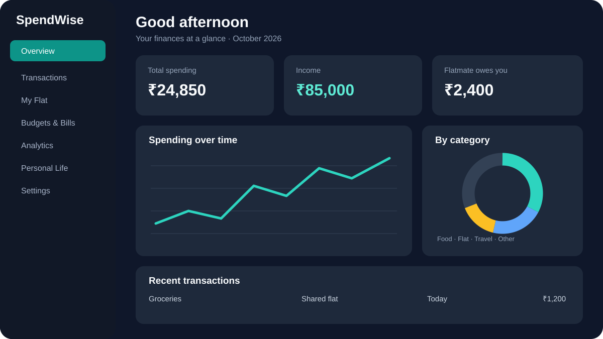
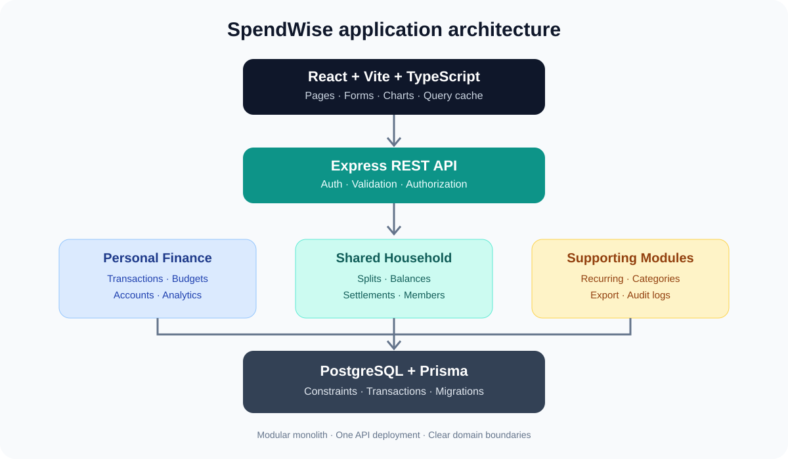
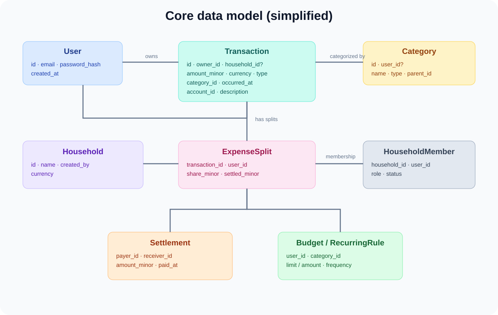

# SpendWise — Advanced Expense Tracker
## Product, Architecture & Development Blueprint

> **Project goal:** Build a personal finance management web app with shared-flat expense splitting, accurate settlement tracking, powerful filters, analytics, and an AI assistant as a later enhancement.

**Initial scope:** Primarily personal finances, with shared flat expenses managed alongside them.  
**Frontend:** React + Vite + TypeScript.  
**Backend:** Node.js + Express + TypeScript.  
**Database:** PostgreSQL + Prisma.  
**Architecture:** Modular monolith with a REST API.

---

## Contents

1. [Product vision](#1-product-vision)
2. [Core features](#2-core-features)
3. [Technology stack](#3-technology-stack)
4. [Architecture](#4-architecture)
5. [Database design](#5-database-design)
6. [Financial rules and balance calculations](#6-financial-rules-and-balance-calculations)
7. [REST API design](#7-rest-api-design)
8. [Repository folder structure](#8-repository-folder-structure)
9. [UI/UX design system](#9-uiux-design-system)
10. [Development phases](#10-development-phases)
11. [Testing strategy](#11-testing-strategy)
12. [Security and privacy](#12-security-and-privacy)
13. [Deployment and operations](#13-deployment-and-operations)
14. [First seven implementation tasks](#14-first-seven-implementation-tasks)
15. [Definition of done](#15-definition-of-done)
16. [Future AI roadmap](#16-future-ai-roadmap)

---

## 1. Product vision

SpendWise should not be a basic expense CRUD app. It should answer questions such as:

- Where did my income go this month?
- How much did I spend on food, travel, shopping, subscriptions, and dates?
- How much have I paid for the flat, and what is my flatmate's outstanding share?
- Which categories increased compared with last month?
- What bills are coming up?
- How much budget remains?
- How can I reduce unnecessary spending?

The product has three related but distinct financial contexts.

### Personal finance
Income, expenses, food, travel, shopping, subscriptions, savings goals, personal bills, and private relationship-related spending.

### Shared flat
Rent, electricity, Wi-Fi, groceries, cleaning supplies, repairs, custom expense splits, household balances, and settlements with a flatmate.

### Insights and management
Cross-category filters, monthly comparisons, recurring bills, budgets, cash-flow analytics, and exportable reports.



### Product principles

1. **Personal-first:** useful even when the flatmate is not using the app.
2. **Privacy by default:** personal transactions remain private.
3. **Financial correctness:** splits and settlements must reconcile.
4. **Fast manual entry:** adding a normal expense should take seconds.
5. **Modular design:** future AI, OCR, and imports should not require rewriting the core.

---

## 2. Core features

### 2.1 Dashboard

- Monthly income, expenses, savings, and cash flow.
- Category breakdown and spending trend charts.
- Budget usage and alerts.
- Flatmate balances and unsettled expenses.
- Upcoming bills and recent transactions.
- Quick actions: Add Expense, Add Income, Split Bill, Settle Up.

### 2.2 Transactions

Each transaction should support:

| Field | Example |
|---|---|
| Amount | ₹1,200 |
| Description | Monthly groceries |
| Category | Food & groceries |
| Context | Personal or Shared Flat |
| Date/time | Transaction date |
| Paid by | Authenticated user or household member |
| Participants | Members who share the cost |
| Split rule | Equal, custom amount, percentage |
| Account | UPI, bank, cash, card |
| Tags | Monthly, essential |
| Receipt | Optional attachment |
| Notes | Optional details |

Capabilities:
- Create, view, edit, duplicate, and soft-delete.
- Search descriptions, notes, and merchants.
- Filter by date, category, context, amount, payer, participants, payment method, and settlement state.
- Sort and paginate.
- Support refunds and account transfers.
- Import/export CSV in a later phase.
- Keep an audit trail for important financial changes.

### 2.3 Shared flat management

- Create a household and invite members.
- Track rent, electricity, Wi-Fi, groceries, cleaning, and repairs.
- Split equally, by custom amounts, percentages, or selected participants.
- Record who paid and each person's share.
- Calculate member balances.
- Record partial or full settlements.
- Keep settlement history and activity logs.
- Ensure household members cannot see one another's private transactions.

**Example:** You pay ₹1,200 for groceries split equally between two members. Your own share is ₹600 and your flatmate owes you ₹600.

### 2.4 Budgets and recurring bills

- Monthly overall and category budgets.
- Separate personal and household budget contexts.
- Optional rollover of unused budget.
- Thresholds at 50%, 75%, 90%, and 100%.
- Recurring rent, Wi-Fi, subscriptions, and other bills.
- Upcoming and overdue bill views.
- Month-over-month comparisons and end-of-month estimates.

### 2.5 Analytics

- Daily, weekly, and monthly trends.
- Category and subcategory breakdowns.
- Current month versus previous month.
- Flat household costs and per-member shares.
- Income versus expenses.
- Forecasted month-end spending based on current trends.

Use line charts for trends, donut charts for category shares, bar charts for period comparisons, and a separate balance view for the household.

### 2.6 Private relationship spending

Keep date nights, gifts, anniversaries, trips, and outings in a private personal category. Track totals and budgets without exposing those transactions to flatmates. Do not infer relationship details automatically; let the user categorize spending.

---

## 3. Technology stack

| Layer | Technology | Reason |
|---|---|---|
| Frontend | React + Vite + TypeScript | Fast development and typed UI |
| Styling | Tailwind CSS + shadcn/ui | Consistent, accessible design |
| Routing | React Router | Page navigation and protected routes |
| Server state | TanStack Query | Cache, mutations, invalidation |
| Forms | React Hook Form + Zod | Typed validation |
| Charts | Recharts | Dashboard and analytics |
| Backend | Node.js + Express + TypeScript | Familiar, modular REST API |
| Database | PostgreSQL | Relationships and transactional consistency |
| ORM | Prisma | Typed queries and migrations |
| Frontend tests | Vitest + React Testing Library | Components and UI logic |
| API tests | Vitest or Jest + Supertest | Service and endpoint testing |
| E2E tests | Playwright | Full user journeys |

PostgreSQL is recommended because transactions, splits, household members, and settlements are strongly relational. MongoDB can also work, but PostgreSQL is a good fit for this domain.

---

## 4. Architecture



Use a **modular monolith**, not microservices. One API deployment can contain well-separated domain modules.

### Request lifecycle

1. Route defines method, URL, and middleware.
2. Middleware authenticates the user and checks permissions.
3. Controller validates the request and forms the HTTP response.
4. Service applies business rules and financial calculations.
5. Repository accesses PostgreSQL through Prisma.
6. Response returns consistent JSON and safe errors.

Keep controllers thin. Put split calculations in a shared balance/settlement service, not in the HTTP controller.

### Architectural rules

- All authoritative data access happens on the server.
- The browser never supplies the authoritative owner ID.
- Personal records are scoped to their owner.
- Household records are scoped to a household the user is authorized to access.
- Split creation and settlements use database transactions.
- Analytics aggregate saved transactions.
- Use integer paise or an exact decimal type, never floating-point numbers as the financial source of truth.
- Use database constraints for row-level invariants and service/transaction logic for cross-row invariants.

---

## 5. Database design



### 5.1 Core entities

#### `users`
- `id`
- `name`
- `email` (unique)
- `password_hash`
- `created_at`
- `updated_at`

#### `accounts`
Tracks cash, bank, UPI, and card accounts.
- `id`
- `user_id`
- `name`
- `type`
- `opening_balance_minor`
- `currency`
- `is_active`

#### `categories`
Supports system defaults and user-defined categories.
- `id`
- `user_id` (nullable for system defaults)
- `name`
- `type`
- `parent_id`
- `icon`
- `color`

#### `transactions`
The central ledger of financial activity.
- `id`
- `owner_id`
- `household_id` (nullable)
- `account_id`
- `category_id`
- `type`
- `amount_minor`
- `currency`
- `description`
- `occurred_at`
- `payment_method`
- `notes`
- `transfer_reference` (nullable)
- `original_transaction_id` (nullable, for refunds)
- `created_at`
- `updated_at`
- `deleted_at` (nullable)

#### `households`
- `id`
- `name`
- `currency`
- `created_by`
- `created_at`

#### `household_members`
- `household_id`
- `user_id`
- `role`
- `status`
- `joined_at`

Use a unique constraint on `(household_id, user_id)` for active membership logic.

#### `expense_splits`
- `id`
- `transaction_id`
- `user_id`
- `share_minor`
- `settled_minor`
- `created_at`

#### `settlements`
- `id`
- `household_id`
- `payer_user_id`
- `receiver_user_id`
- `amount_minor`
- `currency`
- `paid_at`
- `notes`
- `created_by`
- `reversal_of_id` (optional, for explicit corrections)

#### `budgets`
- `id`
- `user_id`
- `category_id` (nullable for overall budget)
- `period`
- `limit_minor`
- `starts_on`
- `ends_on`
- `context`

#### `recurring_rules`
- `id`
- `user_id`
- `household_id` (nullable)
- `category_id`
- `amount_minor`
- `frequency`
- `next_due_at`
- `is_active`

### 5.2 Later tables

Add these when their features are implemented:
- `sessions` or `refresh_sessions`
- `household_invitations`
- `attachments`
- `tags`
- `transaction_tags`
- `recurring_occurrences`
- `audit_logs`
- `saved_filters`
- `notifications`

### 5.3 Transaction types and monetary storage

Initial transaction types:
- `INCOME`
- `EXPENSE`
- `REFUND`
- `TRANSFER`

Store a positive integer amount in minor units and use the type to determine its meaning. For INR, ₹350.75 becomes `35075` paise.

Transfers between the user's own accounts must not count as income or expense. Refunds should link to the original expense where possible so reports can calculate net spending.

### 5.4 Shared expense modeling

A shared transaction stores the full amount once and has separate allocation rows.

For ₹1,200 groceries:
- Transaction amount: ₹1,200.
- User A allocation: ₹600.
- User B allocation: ₹600.
- If User A paid the full amount, User B owes User A ₹600.

Do not count the full shared transaction and the allocation rows as separate personal expenses.

### 5.5 Important constraints

- Amounts must be positive.
- Split shares must sum to the shared transaction amount.
- Settled amounts cannot exceed the relevant allocation.
- Settlement payer and receiver must be different authorized members.
- Accounts, categories, transactions, and participants must belong to the correct authorized context.
- Soft-deleted records must not appear in ordinary reports.
- Cross-row rules such as split-total equality must be enforced through transactional service logic or a suitable database trigger.

---

## 6. Financial rules and balance calculations

Use one shared balance service as the source of truth.

For a member:

`Net position = amount paid − expense share + settlements received − settlements paid`

A positive balance means the person is owed money; a negative balance means the person owes money.

| Item | You | Flatmate |
|---|---:|---:|
| Amount paid | ₹1,200 | ₹0 |
| Expense share | ₹600 | ₹600 |
| Net position | +₹600 | −₹600 |

If the flatmate pays ₹400, the remaining amount owed is ₹200.

For a household with all expenses and settlements consistently accounted for:

`Sum of all member net positions = 0`

Never store a freely editable `balance_owed` as the financial truth. Calculate balances from expenses, allocations, and settlement records. Corrections should use explicit reversals or adjustments, not silently mutate history.

---

## 7. REST API design

Base path: `/api/v1`

### Authentication and profile

| Method | Endpoint | Purpose |
|---|---|---|
| POST | `/auth/register` | Register |
| POST | `/auth/login` | Sign in |
| POST | `/auth/logout` | End session |
| GET | `/auth/me` | Current user |
| PATCH | `/users/me` | Update profile |
| PATCH | `/users/me/password` | Change password |

### Transactions

| Method | Endpoint | Purpose |
|---|---|---|
| GET | `/transactions` | Search, filter, sort, paginate |
| POST | `/transactions` | Create |
| GET | `/transactions/:id` | Read |
| PATCH | `/transactions/:id` | Update |
| DELETE | `/transactions/:id` | Soft-delete |
| POST | `/transactions/:id/duplicate` | Duplicate |
| GET | `/transactions/export` | Export filtered results |

Example:

`GET /api/v1/transactions?from=2026-10-01&to=2026-10-31&type=EXPENSE&context=PERSONAL&minAmount=10000&maxAmount=500000&page=1&limit=20`

Document amount units explicitly. In this example, amount bounds are in paise. Use allowlists for sort fields and bounded pagination.

### Categories and accounts

| Method | Endpoint | Purpose |
|---|---|---|
| GET / POST | `/categories` | List or create |
| PATCH / DELETE | `/categories/:id` | Update or archive |
| GET / POST | `/accounts` | List or create |
| PATCH | `/accounts/:id` | Update |
| GET | `/accounts/:id/summary` | Balance summary |

### Household and settlement

| Method | Endpoint | Purpose |
|---|---|---|
| POST | `/households` | Create flat space |
| GET | `/households` | List accessible households |
| GET | `/households/:id` | Household details |
| POST | `/households/:id/invitations` | Invite member |
| POST | `/invitations/:token/accept` | Accept invitation |
| GET | `/households/:id/members` | List members |
| POST | `/households/:id/transactions` | Create shared expense |
| GET | `/households/:id/transactions` | List shared expenses |
| GET | `/households/:id/balances` | Calculate balances |
| POST | `/households/:id/settlements` | Record settlement |
| GET | `/households/:id/settlements` | Settlement history |

### Budgets, recurring rules, and analytics

| Method | Endpoint | Purpose |
|---|---|---|
| GET / POST | `/budgets` | List or create |
| PATCH / DELETE | `/budgets/:id` | Update or archive |
| GET / POST | `/recurring-rules` | List or create |
| PATCH | `/recurring-rules/:id` | Update |
| POST | `/recurring-rules/:id/skip` | Skip an occurrence |
| GET | `/analytics/overview` | Dashboard summary |
| GET | `/analytics/spending-trends` | Trend series |
| GET | `/analytics/category-breakdown` | Category totals |
| GET | `/analytics/month-comparison` | Compare periods |
| GET | `/analytics/cash-flow` | Income versus spending |

Analytics endpoints should share the same date and context semantics as the transaction list.

### Example create-transaction payload

```json
{
  "type": "EXPENSE",
  "amountMinor": 120000,
  "currency": "INR",
  "description": "Monthly groceries",
  "categoryId": "food-category-id",
  "accountId": "upi-account-id",
  "occurredAt": "2026-10-12T12:30:00+05:30",
  "context": "HOUSEHOLD",
  "householdId": "flat-id",
  "paymentMethod": "UPI",
  "splits": [
    { "userId": "your-user-id", "shareMinor": 60000 },
    { "userId": "flatmate-user-id", "shareMinor": 60000 }
  ]
}
```

The server must validate IDs, membership, payer identity, and split totals. Derive the authenticated owner from the session rather than trusting a client-supplied owner ID. Define the payer explicitly or use an authenticated-payer rule in the API contract.

### API conventions

- Use consistent JSON response envelopes.
- Return stable error codes and safe messages.
- Never expose stack traces or database errors.
- Validate input with Zod.
- Use idempotency protection for operations where duplicate submissions could cause duplicate financial effects.
- Use transactions for multi-row writes.

---

## 8. Repository folder structure

```text
spendwise/
├── client/
│   ├── public/
│   └── src/
│       ├── app/
│       │   ├── router.tsx
│       │   ├── providers.tsx
│       │   └── query-client.ts
│       ├── components/
│       │   ├── ui/
│       │   ├── layout/
│       │   ├── charts/
│       │   └── shared/
│       ├── features/
│       │   ├── auth/
│       │   ├── dashboard/
│       │   ├── transactions/
│       │   ├── categories/
│       │   ├── accounts/
│       │   ├── household/
│       │   ├── settlements/
│       │   ├── budgets/
│       │   ├── recurring/
│       │   └── analytics/
│       ├── hooks/
│       ├── lib/
│       ├── services/
│       ├── types/
│       ├── styles/
│       ├── App.tsx
│       └── main.tsx
│
├── server/
│   ├── prisma/
│   │   ├── schema.prisma
│   │   ├── migrations/
│   │   └── seed.ts
│   └── src/
│       ├── config/
│       ├── middleware/
│       ├── modules/
│       │   ├── auth/
│       │   ├── users/
│       │   ├── transactions/
│       │   ├── categories/
│       │   ├── accounts/
│       │   ├── households/
│       │   ├── settlements/
│       │   ├── budgets/
│       │   ├── recurring/
│       │   └── analytics/
│       ├── common/
│       ├── app.ts
│       └── server.ts
│
├── packages/
│   └── contracts/     # Optional shared schemas and API types
├── docs/
│   ├── architecture.md
│   ├── database.md
│   └── api.md
├── .env.example
├── .gitignore
├── package.json
└── README.md
```

A typical backend module:

```text
transactions/
├── transaction.routes.ts
├── transaction.controller.ts
├── transaction.service.ts
├── transaction.repository.ts
├── transaction.schema.ts
├── transaction.types.ts
└── transaction.service.test.ts
```

Modules should call public domain services instead of reaching into another module's repository and bypassing its business rules.

---

## 9. UI/UX design system

### Visual direction


Aim for a premium, understated finance dashboard:
- Charcoal/slate surfaces with teal or emerald accents.
- Warm neutral light theme and matching dark theme.
- Clear typography and tabular numerals for amounts.
- Restrained semantic color usage.
- Accessible contrast and visible keyboard focus.

### Suggested design tokens

| Token | Value |
|---|---|
| Font | Inter or Geist |
| Base spacing | 4 px |
| Card radius | 12–16 px |
| Input/button height | 40–44 px |
| Desktop content padding | 24 px |
| Mobile content padding | 16 px |
| Primary accent | `#0D9488` |
| Dark background | `#171B24` |
| Light surface | `#F8FAFC` |
| Neutral border | `#E2E8F0` |

Use semantic theme tokens rather than hardcoding colors across components.

### Navigation

- Overview
- Transactions
- My Flat
- Budgets & Bills
- Analytics
- Personal Life (private)
- AI Assistant (later)
- Settings

### Responsive layout

**Desktop**
- Sidebar approximately 240–260 px.
- Top bar with page title, date selector, notifications, and profile.
- Summary cards and charts in a responsive grid.
- Prominent Add Expense action.

**Mobile**
- Compact header and bottom navigation.
- Full-screen or bottom-sheet transaction form.
- Filter chips and stacked charts.
- Transaction rows become readable cards.

### Add Expense flow

1. Enter amount.
2. Choose category.
3. Choose Personal or Shared Flat.
4. Choose date and account.
5. For shared expenses, select participants and split rule.
6. Add optional notes or tags.
7. Save.

Use sensible defaults, inline validation, keyboard navigation, and a success toast. Preserve form data if saving fails.

---

## 10. Development phases

### Phase 1 — Foundation
- Initialize client and server TypeScript apps.
- Configure PostgreSQL, Prisma, migrations, and seed data.
- Add linting, formatting, environment validation, and centralized error handling.
- Implement register, login, logout, current-user endpoint, and protected routes.
- Build the initial app shell and seed default categories.

**Acceptance:** a user can sign in and refresh the app without losing a secure authenticated session.

### Phase 2 — Personal finance
- Implement accounts, categories, and transaction CRUD.
- Add income, expenses, refunds, and transfers.
- Build Add Expense and transaction list.
- Add search, date filters, sorting, pagination, and soft deletion.
- Build dashboard totals and category summaries.
- Test net spending, refund handling, and transfer exclusions.

**Acceptance:** transactions produce correct totals and remain isolated by user.

### Phase 3 — Shared flat
- Create households and memberships.
- Implement invitations and authorization.
- Add equal and custom-amount splits.
- Implement balance calculation and settlement records.
- Add shared expense filters and settlement history.
- Test partial payments, rounding, edits, and reversals.

**Acceptance:** two test users see correct shared balances, while private transactions remain inaccessible to one another.

### Phase 4 — Budgets and analytics
- Add category and overall budgets.
- Add recurring transaction rules.
- Implement category breakdowns and month comparisons.
- Add saved filters and CSV export.
- Add upcoming bills and threshold alerts.
- Test reports against known fixtures.

**Acceptance:** dashboard, analytics, and filtered transactions agree on totals and date boundaries.

### Phase 5 — Production readiness
- Add integration and end-to-end tests.
- Review authorization and household isolation.
- Add rate limits and secure session handling.
- Add pagination limits, database indexes, and structured logging.
- Deploy frontend, API, and managed PostgreSQL.
- Configure backups, monitoring, migrations, and error reporting.

**Acceptance:** deployed registration, personal expenses, and shared settlements work without exposing private data.

### Phase 6 — Advanced features
- Receipt upload and OCR.
- AI-powered spending questions.
- Natural-language transaction entry.
- Recurring payment reminders.
- Forecasting and anomaly detection.
- Optional import integrations.

---

## 11. Testing strategy

| Scenario | Expected result |
|---|---|
| Expense of ₹500 | Spending increases by ₹500 |
| Transfer of ₹1,000 | Spending and income remain unchanged |
| Refund of ₹200 | Net expense decreases by ₹200 |
| ₹1,200 split equally | Each share is ₹600 |
| ₹400 partial settlement | Outstanding debt reduces by ₹400 |
| Split totals exceed amount | Request rejected |
| User accesses another user's transaction | Access denied |
| Non-member accesses household records | Access denied |
| Duplicate settlement request | No double settlement |
| Transaction edited after settlement | Consistent balances or explicit adjustment required |

Test the balance engine with generated cases. For each fully accounted household, member net positions should sum to zero.

Also test:
- Month-boundary and timezone behavior.
- Soft deletion and analytics.
- Concurrent settlement requests.
- Permission checks for every household endpoint.
- Validation failures and safe error responses.
- CSV exports with active filters.

---

## 12. Security and privacy

- Hash passwords with a modern password-hashing algorithm.
- Use secure HTTP-only cookies and appropriate CSRF protection when using cookie-based sessions.
- Validate all incoming requests on the server.
- Derive identity from the authenticated session.
- Enforce owner and household membership checks in service/repository access paths.
- Rate-limit authentication and sensitive endpoints.
- Keep secrets out of source control; use environment variables or a secrets manager.
- Use HTTPS in production.
- Limit file upload type and size; store receipt files privately.
- Audit important changes to shared financial records.
- Back up the database and periodically test restores.
- Keep personal relationship spending private by default.
- Make AI data access permission-aware and read-only initially.

---

## 13. Deployment and operations

Recommended deployment shape:
- **Frontend:** static hosting for the Vite build.
- **API:** a Node.js-compatible application host.
- **Database:** managed PostgreSQL.
- **Uploads:** private object storage if receipts are introduced.

Production checklist:
- Configure frontend API URL and server environment variables.
- Run migrations as a controlled deployment step.
- Configure allowed origins and cookie settings.
- Enable HTTPS and health checks.
- Add structured logs and error monitoring.
- Configure automated backups and restore tests.
- Set up a development seed dataset; never use real financial records as public demo data.

---

## 14. First seven implementation tasks

1. **Create repository and app structure:** client, server, TypeScript, linting, and environment configuration.
2. **Configure PostgreSQL and Prisma:** schema, initial migration, and seed data.
3. **Implement authentication:** register, login, logout, current-user endpoint, and protected routes.
4. **Build the application shell:** sidebar, responsive layout, top bar, design tokens, and navigation.
5. **Implement categories and accounts:** defaults, CRUD, and ownership validation.
6. **Build personal transaction CRUD:** expense/income forms, list, search, filters, and pagination.
7. **Connect the overview dashboard:** monthly totals, recent transactions, and category summaries from the API.

---

## 15. Definition of done

The first release is ready when a user can:

- Create an account and record personal expenses.
- Filter by category, date, amount, and context.
- View accurate income, expenditure, and category analytics.
- Create a flat space and invite a friend.
- Record shared bills and allocate costs.
- View member balances and record partial or full settlements.
- Keep personal relationship-related spending private.
- Sign out and sign back in without losing data.
- Verify that unauthorized users cannot access private or shared records.
- Export transactions and deploy the app successfully.

---

## 16. Future AI roadmap

Build AI only after transaction and settlement logic is reliable.

Potential prompts:
- “Where did most of my money go this month?”
- “Compare food spending with last month.”
- “How much does my flatmate owe me?”
- “Can I afford a ₹5,000 purchase within my budget?”
- “Suggest three ways to reduce expenses next month.”

### Recommended implementation

1. User asks a question.
2. Backend maps it to a validated, authorized tool.
3. Application runs deterministic SQL aggregations or balance calculations.
4. The model explains the results in plain language.
5. The UI renders an answer, chart, or table.

Do not ask the model to invent totals or send unrestricted database access to the LLM. Keep the assistant read-only at first. Require explicit confirmation before saving any AI-proposed transaction.

### Final recommendation

Build the transaction model, dashboard, and split/settlement engine first. They are the foundation for everything else. Add budgets and analytics next, then AI and receipt scanning after the financial calculations and privacy controls have been tested.

**Guiding principle:** reliable financial data first, delightful experience second, AI third.
